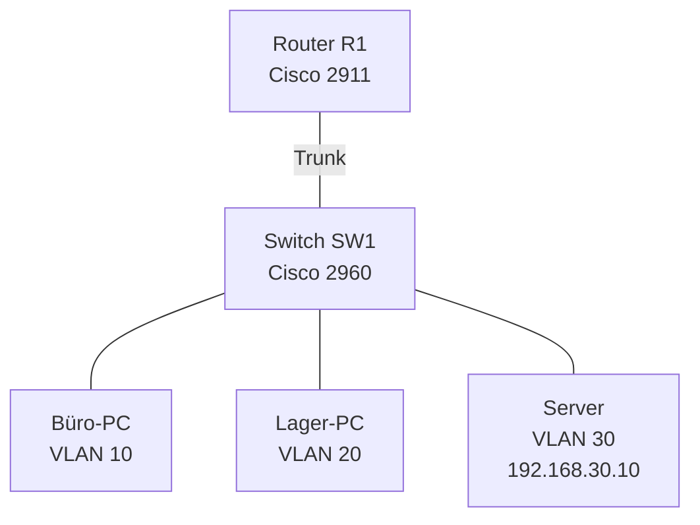

# Muster Logistik AG – Netzwerkplan

## Netzwerkaufbau

Router R1
    |
Switch SW1
    |
    +-- Büro-PC    (VLAN 10)
    |
    +-- Lager-PC   (VLAN 20)
    |
    +-- Server     (VLAN 30)

## IP-Adressplan

| Bereich | VLAN | Netzwerk | Gateway |
|---|---|---|---|
| Büro | 10 | 192.168.10.0/24 | 192.168.10.1 |
| Lager | 20 | 192.168.20.0/24 | 192.168.20.1 |
| Server | 30 | 192.168.30.0/24 | 192.168.30.1 |

Server-IP: 192.168.30.10

## Ziel

Die Abteilungen werden durch VLANs logisch getrennt.
Der Router ermöglicht die Kommunikation zwischen den VLANs.
Die Büro- und Lager-PCs erhalten ihre IP-Adressen per DHCP.
Der Server verwendet eine feste IP-Adresse.

## Netzwerkdiagramm

